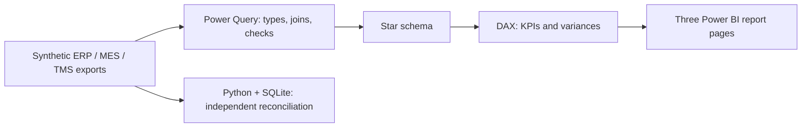

<div align="center">


    

**Is rising production cost driven by volume, material consumption or operating efficiency?**

[Power BI project](model/Analytics.pbip) · [Data model](docs/model.md) · [DAX measures](dax/measures.dax) · [Management brief](docs/management-brief.md)

</div>

# Production Controlling

## 📚 Table of contents

- [Business objective](#-business-objective)
- [Preview and findings](#-preview-and-findings)
- [Report scope](#-report-scope)
- [Technologies and data flow](#-technologies-and-data-flow)
- [Getting started](#-getting-started)
- [Data quality and automation](#-data-quality-and-automation)
- [Project structure](#-project-structure)
- [Methodology and limitations](#-methodology-and-limitations)

## 🎯 Business objective

Unit cost, variances and production efficiency. This portfolio project demonstrates the complete analytical workflow: operational exports, a star schema, business measures and a concise recommendation for company owners. It contains **4,320 fact records across 24 months**, from January 2024 to December 2025.

> **Demonstration project.** All data is synthetic. This is not a deployment for BPO NETWORK or an integration with a live Comarch ERP Optima database.

## 📊 Preview and findings


*This illustration is calculated from the repository’s data. It is not a screenshot from Power BI Desktop. The interactive report is defined in the PBIP/PBIR source files.*

| Metric — full period, no filters | Reference result |
|---|---:|
| Production cost | PLN 53.44m |
| Cost per good unit | PLN 83.96 |
| Scrap rate | 2.8% |
| OEE | 62.5% |

Line 2 has a **4.23% scrap rate**. Across the complete demonstration dataset, actual production cost exceeds the flexible budget by **PLN 1,815,975.95**.

**Recommendation:** Investigate scrap on Line 2 by product and batch. Compare actual cost with the standard cost of actual good output, separating the volume effect from the efficiency variance. Review standards with the production engineer.

## 🔎 Report scope

| Report page | Purpose |
|---|---|
| 01 — Production overview | Four KPIs, a trend chart, a breakdown and a detailed table |
| 02 — Cost variances | Compare business dimensions and investigate variances |
| 03 — Quality and efficiency | Explore operational drivers and support business decisions |

Each page includes a month slicer and a business-dimension slicer. Selecting a chart item filters other visuals.

The model includes month-over-month, year-over-year and year-to-date measures. Additional measures can be added to visuals from the model pane. Select a single month when interpreting month-over-month KPI cards.

The README and its illustrations are in English. Native report labels, DAX measure names and supporting business documents remain in Polish to reflect the target role; page names above are English descriptions.

## 🧰 Technologies and data flow



| Relevant analytical skill | Evidence in this repository |
|---|---|
| Combining multiple sources | [Power Query scripts](power-query) with join-cardinality checks |
| Power BI and data modeling | [Semantic model](model/Analytics.SemanticModel/model.bim), one-to-many relationships |
| DAX and period analysis | [Measure catalog](dax/measures.dax), DIVIDE, CALCULATE, DATEADD and YTD |
| SQL | [Ad hoc analytical query](sql/analysis.sql), executed in SQLite |
| Automation and data quality | [Validation script](scripts/validate.py) and GitHub Actions workflow |
| Business communication | [Management brief](docs/management-brief.md), actionable recommendations and explicit limitations |
| Excel | [Optional exercise](docs/excel-workflow.md); no completed workbook is included |

## 🚀 Getting started

1. Clone this repository on Windows with a current version of **Power BI Desktop** supporting PBIP and PBIR. Enable the Power BI Project preview option if required by your version. The semantic model uses TMSL in `model.bim`.
2. Before opening the report, configure the local data path:

   ```powershell
   python scripts/configure.py
   ```

   This sets the `DataRoot` Power Query parameter to the absolute path of this checkout’s `data` folder. Alternatively, change the parameter in Power Query. Do not commit your local path. Before committing, restore the portable placeholder:

   ```powershell
   python scripts/configure.py --reset
   ```

3. Open **[model/Analytics.pbip](model/Analytics.pbip)**. Select **Refresh** and apply query changes if prompted. The repository does not include a data cache, so the first refresh is required.
4. Reconcile full-period totals with the table above and [control-totals.json](docs/control-totals.json). Then select a month and a business dimension. Use one selected month for month-over-month cards.
5. If you need a single binary file, use **Save as → .pbix** after a successful refresh. This repository stores editable PBIP/PBIR source files instead of a binary cache.

Official documentation: [Power BI projects](https://learn.microsoft.com/en-us/power-bi/developer/projects/projects-overview), [PBIR report definitions](https://learn.microsoft.com/en-us/power-bi/developer/projects/projects-report).

## ✅ Data quality and automation

```powershell
python scripts/validate.py
```

Checks cover key uniqueness, relationships, date coverage, reconciliation to raw sources, metric bounds and SQL output. GitHub Actions runs these checks on pushes and pull requests. The [data validation report](docs/validation.json) and [Microsoft schema validation report](docs/schema-validation.json) document the checks performed and their limits.

CSV files in `data/curated` are reference outputs for independent validation and SQL practice. Power BI reads the raw sources and transforms them in Power Query, avoiding manual copying between reports.

To regenerate the same synthetic dataset:

```powershell
python scripts/generate_data.py
python scripts/validate.py
```

## 🗂 Project structure

```text
model/           # PBIP, native PBIR report and TMSL semantic model
data/raw/        # Independent synthetic operational source files
data/dimensions/ # Calendar and dimension tables
data/curated/    # Reference outputs for Python/SQL reconciliation
power-query/     # Readable copies of M queries embedded in the model
dax/             # Catalog of measures embedded in the model
sql/             # Ad hoc business analysis
scripts/         # Configuration, validation and data generation
docs/            # Methodology, data dictionary, findings and checks
assets/          # Cover and static data preview
```

## 📌 Methodology and limitations

**Fact-table grain:** One production batch per BatchID, with one product and one production line.

Static budget = planned units × standard unit cost. Flexible budget = good units × standard unit cost. Volume effect = flexible budget − static budget. Efficiency variance = actual cost − flexible budget. Their sum reconciles to total variance. Unit cost = total production cost / good units. OEE = availability × performance × quality, calculated from ratios of summed inputs, not an average of batch percentages. MaterialCostPLN is the value of material consumption from the ERP export, not a unit price.

Batches represent independent planned 480-minute production windows; the model does not reconstruct a machine schedule. It excludes work in progress, depreciation and full accounting inventory valuation. Portfolio OEE follows the documented component-based definition, rather than claiming a universal aggregation standard across technologies.

**Verification status:** data, source structure and report JSON schemas have been checked. Opening the project, refreshing M queries, executing DAX and rendering the native report still require validation in Power BI Desktop. No successful Desktop test is claimed. See the [detailed methodology](docs/methodology.md).

Prepared with AI assistance; reference calculations are independently checked in Python and SQL. Recommendations apply only to the demonstration scenario. Licensed under the MIT License.
