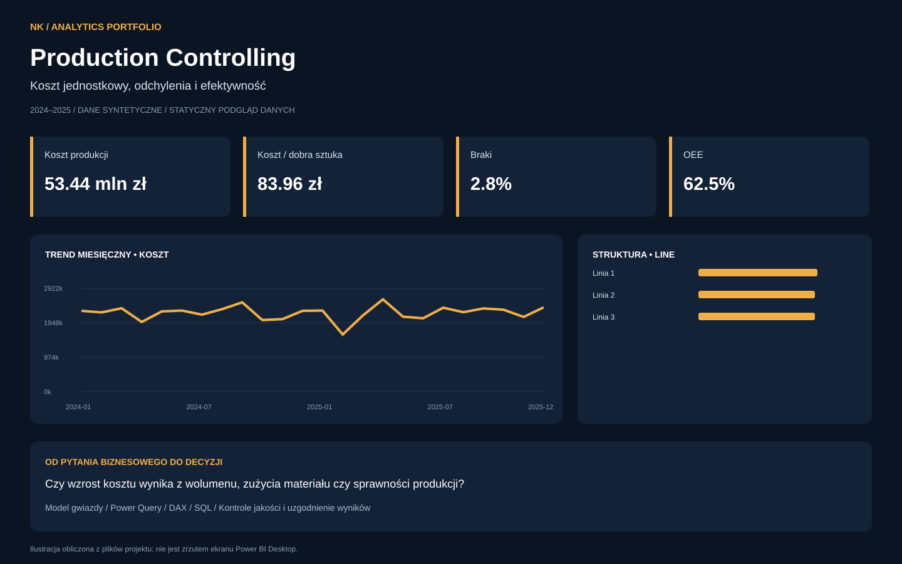
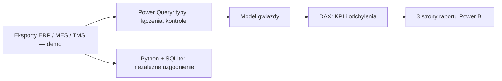

<div align="center">


    

**Czy wzrost kosztu wynika z wolumenu, zużycia materiału czy sprawności produkcji?**

[Raport](model/Analytics.pbip) · [Model danych](docs/model.md) · [Miary DAX](dax/measures.dax) · [Wnioski](docs/management-brief.md)

</div>

## 📚 Spis treści

- [Cel biznesowy](#-cel-biznesowy)
- [Podgląd i wyniki](#-podgląd-i-wyniki)
- [Zakres analizy](#-zakres-analizy)
- [Technologie i przepływ danych](#-technologie-i-przepływ-danych)
- [Uruchomienie](#-uruchomienie)
- [Jakość danych i automatyzacja](#-jakość-danych-i-automatyzacja)
- [Struktura projektu](#-struktura-projektu)
- [Założenia i ograniczenia](#-założenia-i-ograniczenia)

## 🎯 Cel biznesowy

Koszt jednostkowy, odchylenia i efektywność. Projekt portfolio pokazuje proces od eksportów operacyjnych przez model gwiazdy i wskaźniki po krótką rekomendację dla właściciela firmy. Obejmuje 4,320 rekordów faktów z 24 miesięcy.

> **Projekt demonstracyjny.** Wszystkie dane są syntetyczne. Nie jest to wdrożenie dla BPO NETWORK ani integracja z rzeczywistą bazą Comarch ERP Optima.

## 📊 Podgląd i wyniki



*Ilustracja obliczona z danych repozytorium, nie zrzut z Power BI Desktop. Interaktywny raport jest zdefiniowany w plikach PBIP/PBIR.*

| Wskaźnik — cały okres, bez filtrów | Wynik kontrolny |
|---|---:|
| Koszt produkcji | 53.44 mln zł |
| Koszt / dobra sztuka | 83.96 zł |
| Braki | 2.8% |
| OEE | 62.5% |

Linia 2 ma **4.23% braków**. Odchylenie kosztu od budżetu elastycznego wynosi **1,815,975.95 PLN** w całym zbiorze.

**Rekomendacja:** Przeanalizować przyczyny braków na linii 2 według produktu i partii. Porównywać koszt do standardu dla faktycznej liczby dobrych sztuk; oddzielić efekt wolumenu od odchylenia efektywności. Zweryfikować standardy z technologiem.

## 🔎 Zakres analizy

| Strona raportu | Sposób pracy |
|---|---|
| 01 | Wynik produkcji | Cztery KPI, trend, struktura i tabela szczegółów |
| 02 | Odchylenia kosztów | Porównanie przekrojów i identyfikacja odchyleń |
| 03 | Jakość i efektywność | Wskaźniki operacyjne, szczegóły i wsparcie decyzji |

Każda strona ma filtr miesiąca i wymiaru biznesowego. Wybór elementu wykresu filtruje pozostałe wizualizacje. Miary obejmują m/m, r/r i YTD; dodatkowe miary można umieszczać na wizualizacjach z panelu modelu.

## 🧰 Technologie i przepływ danych



| Kompetencja z roli analityka | Dowód w projekcie |
|---|---|
| Łączenie wielu źródeł | [Zapytania M](power-query) i kontrola kardynalności połączeń |
| Power BI i modelowanie | [Model semantyczny](model/Analytics.SemanticModel/model.bim), relacje 1:N |
| DAX i analiza okresów | [Katalog miar](dax/measures.dax), DIVIDE, CALCULATE, DATEADD, YTD |
| SQL | [Zapytanie analityczne](sql/analysis.sql), wykonywane w SQLite |
| Automatyzacja i jakość | [Kontrole](scripts/validate.py), workflow GitHub Actions |
| Komunikacja z biznesem | [Notatka zarządcza](docs/management-brief.md), jawne ograniczenia |
| Excel | [Dodatkowe ćwiczenie](docs/excel-workflow.md); bez gotowego skoroszytu |

## 🚀 Uruchomienie

1. Sklonuj repozytorium na Windows z aktualnym **Power BI Desktop** obsługującym PBIP i PBIR. W razie potrzeby włącz Power BI Project w opcjach funkcji zapoznawczych. Format modelu: TMSL `model.bim`.
2. Ustaw lokalną ścieżkę danych przed otwarciem raportu:

   ```powershell
   python scripts/configure.py
   ```

   Skrypt ustawia parametr `DataRoot` na bezwzględną ścieżkę folderu `data` w tej kopii. Alternatywnie zmień parametr w Power Query. Nie commituj lokalnej ścieżki; przed commitem: `python scripts/configure.py --reset`.

3. Otwórz **[model/Analytics.pbip](model/Analytics.pbip)**. Wybierz **Odśwież**, a gdy Desktop o to poprosi — zastosuj zmiany zapytań. Bez odświeżenia plik nie ma pamięci podręcznej danych.
4. Sprawdź pełne sumy z tabelą powyżej i [control-totals.json](docs/control-totals.json). Wybierz miesiąc oraz wymiar biznesowy. Dla m/m wybierz pojedynczy miesiąc.
5. Jeśli potrzebujesz jednego pliku, po poprawnym odświeżeniu użyj **Zapisz jako → .pbix**. W repozytorium świadomie przechowujemy edytowalne źródła PBIP/PBIR, bez binarnego cache.

Oficjalna dokumentacja: [projekty Power BI](https://learn.microsoft.com/en-us/power-bi/developer/projects/projects-overview), [PBIR](https://learn.microsoft.com/en-us/power-bi/developer/projects/projects-report).

## ✅ Jakość danych i automatyzacja

```powershell
python scripts/validate.py
```

Kontrole obejmują unikalność kluczy, relacje, zakres dat, uzgodnienie wartości z surowymi źródłami, granice wskaźników i wynik zapytania SQL. Workflow GitHub Actions uruchamia je przy push i pull request. [Raport walidacji danych](docs/validation.json) i [walidacja schematów Microsoft](docs/schema-validation.json) opisuje wynik kontroli oraz zakres, którego nie sprawdzono w silniku Desktop.

CSV w `curated` służą do niezależnej walidacji i ćwiczenia SQL; Power BI pobiera surowe źródła i przekształca je w M. Nie trzeba ręcznie kopiować danych między raportami.

## 🗂 Struktura projektu

```text
model/          # PBIP, natywny raport PBIR, semantyczny model TMSL
data/raw/       # niezależne źródła operacyjne demo
data/dimensions/# kalendarz i słowniki
data/curated/   # wynik referencyjny do kontroli Python/SQL
power-query/    # czytelne kopie zapytań M osadzonych w modelu
dax/            # katalog miar osadzonych w modelu
sql/            # analizy ad hoc
scripts/        # konfiguracja, kontrole, generator danych
docs/           # metodyka, słownik danych, wnioski, walidacja
assets/         # okładka i statyczny podgląd danych
```

## 📌 Założenia i ograniczenia

Budżet statyczny = planowane sztuki × standard. Budżet elastyczny = dobre sztuki × standard. Efekt wolumenu = elastyczny − statyczny. Efekt efektywności = koszt rzeczywisty − elastyczny. Suma obu = odchylenie całkowite. Koszt jednostkowy = całkowity koszt / dobre sztuki. OEE = (czas pracy / planowany czas) × (idealny czas / czas pracy) × (dobre / wszystkie sztuki); ilorazy sum, nie średnia OEE partii. MaterialCostPLN to wartość rozchodu z ERP, nie cena jednostkowa.

Partie traktowane są jako niezależne zaplanowane okna po 480 minut, bez rekonstrukcji harmonogramu maszyn. Model nie uwzględnia WIP, amortyzacji ani pełnej księgowej wyceny zapasu. OEE całego portfela to zdefiniowany wskaźnik z komponentów, nie uniwersalny standard agregacji różnych technologii.

**Status weryfikacji:** sprawdzono dane i strukturę źródeł; uruchomienie, odświeżenie M, wykonanie DAX i renderowanie natywnego raportu wymagają Power BI Desktop. Nie deklarujemy testu Desktop, którego nie przeprowadzono. [Szczegółowa metodyka](docs/methodology.md).

Projekt przygotowany z pomocą AI; obliczenia kontrolowane niezależnie w Python/SQL. Rekomendacje dotyczą wyłącznie scenariusza demo. Licencja MIT.
